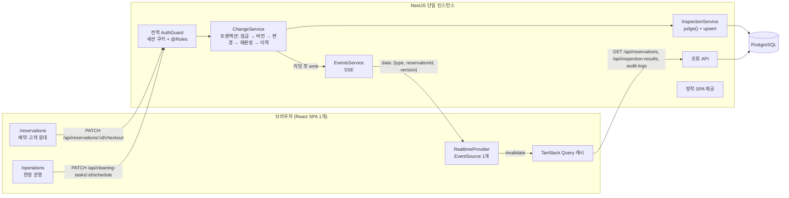
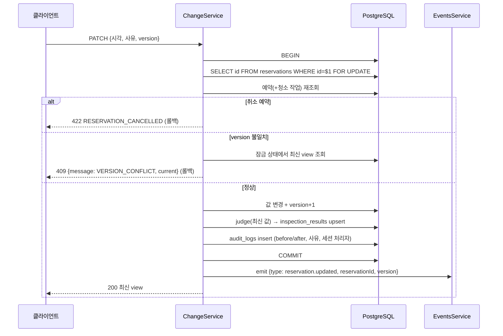

# 설계

요구 원본은 `GOAL.md`, 구현 명세는 `docs/superpowers/specs/2026-10-25-checkout-cleaning-inspection-design.md`이다. 이 문서는 구현된 상태를 기준으로 쓴다.

## 1. 구조

- 실행 단위는 앱 컨테이너 1개(Nest가 API와 빌드된 SPA를 함께 제공)와 DB 1개다. BE는 상시 실행되는 단일 인스턴스를 전제로 한다.
- 화면은 React 앱 하나에서 경로로 나눈다. 역할별 FE 앱을 따로 만들지 않았다.

### 저장소 구성 (npm workspaces)

| 경로 | 역할 |
|---|---|
| `apps/server` | NestJS 10, Prisma 5, Jest. `src/auth`(계정·세션·가드), `src/inspection`(`judge`, 재점검, 예약 잠금), `src/changes`(쓰기 트랜잭션, DTO), `src/reservations`·`src/cleaning`(컨트롤러), `src/events`(SSE), `prisma/`(스키마, 마이그레이션, 시드), `test/`(통합 테스트), `scripts/`(setup, test-int, seed-if-empty) |
| `apps/web` | Vite + React 18 + TypeScript, TanStack Query 5, React Router 6. `pages/`(두 화면), `realtime/`(SSE 훅), `auth/`, `lib/kst.ts`(KST 변환) |
| `e2e` | Playwright 1.53.2, 스크린샷 스크립트 |

`apps/`에는 서비스만 둔다. e2e는 서비스가 아니므로 루트 `e2e/`에 둔다. FE와 BE가 공유하는 타입 패키지는 만들지 않았다. 각자 view 타입을 선언하고, 형태가 어긋나면 e2e가 잡는다.

## 2. 데이터 모델

| 테이블 | 주요 컬럼 | 제약 |
|---|---|---|
| `reservations` | `id` text PK, `room_id`, `guest_name`, `checkout_at` timestamptz NULL, `status`(`CONFIRMED`/`CANCELLED`), `version` int, `updated_at` | — |
| `cleaning_tasks` | `id` text PK, `reservation_id` FK, `type`(`CHECKOUT`/`STAYOVER`), `scheduled_start_at` timestamptz NULL, `status`(`SCHEDULED`/`CANCELLED`), `version` int | 부분 유니크 인덱스 `cleaning_tasks_one_checkout_per_reservation ON (reservation_id) WHERE type = 'CHECKOUT'` |
| `inspection_results` | `reservation_id` PK·FK, `status`(5개 enum), `reason_code`, `checked_at` timestamptz | PK가 예약 id라 예약당 1건만 존재 |
| `audit_logs` | `id` bigserial, `reservation_id` FK, `action`(`CHECKOUT_CHANGED`/`CLEANING_RESCHEDULED`), `before` jsonb, `after` jsonb, `reason` NULL, `actor_id`, `actor_role`, `created_at` timestamptz | — |

- 예약당 퇴실 청소 1건은 부분 유니크 인덱스로 강제한다. 재실 청소는 같은 예약에 함께 있을 수 있다. Prisma 스키마로 표현할 수 없어 마이그레이션 SQL에 직접 작성했다.
- 점검 결과는 `reservation_id`를 PK로 두고 upsert만 하므로 점검을 반복해도 행이 늘지 않는다.
- 모든 FK는 `ON DELETE RESTRICT`다.
- 시각은 `timestamptz(3)`로 저장하고 API는 UTC ISO 문자열로 주고받는다. 화면은 `Asia/Seoul`로 표시하고, 입력은 KST로 해석해 UTC ISO로 보낸다(`apps/web/src/lib/kst.ts`). 웹 테스트는 `TZ=America/New_York`, e2e는 `timezoneId: America/New_York`로 실행해 브라우저 시간대에 의존하지 않음을 확인한다.
- 상태·시각·관계는 명시적 컬럼이다. 이력의 전후 값(변경한 시각, 판정 상태)만 JSON이다.
- 청소 일정 변경은 청소 작업의 `version`만 올리고 예약의 `version`은 그대로 둔다.

## 3. 판정

`judge`(`apps/server/src/inspection/judge.ts`)는 DB나 시간대에 의존하지 않는 순수 함수다. 순서와 근거 문구는 README §3 표와 같다.

- 체크아웃 누락을 청소 작업 부재보다 먼저 본다. 비교 기준 자체가 없으면 판정 불가가 맞다고 판단했다.
- 취소된 청소 작업은 "작업 없음"과 같게 본다.
- 판정 입력은 퇴실 청소(`type = CHECKOUT`)만 받는다. 재실 청소는 조회 단계에서 제외한다.
- 정보가 없는 경우는 `NORMAL`이 되지 않는다.

## 4. 쓰기 처리: 트랜잭션, 잠금, 버전

두 변경 경로는 같은 절차를 하나의 `prisma.$transaction` 안에서 수행한다.

- **같은 예약 행을 먼저 잠근다.** 체크아웃 변경과 청소 일정 변경 모두 `lockReservation`(`apps/server/src/inspection/reservation-lock.ts`)으로 예약 행에 `FOR UPDATE`를 건다. 같은 예약에 대한 두 경로가 직렬화되므로 마지막 커밋의 판정은 항상 최종 저장값으로 계산된다. 통합 테스트에서 `FOR UPDATE`를 제거하면 동시 수정 일치 테스트가 실패했다(Task 8 구현 보고, 2/2회).
- **전체 재점검(`runAll`)도 같은 잠금을 쓴다.** 예약마다 별도 트랜잭션에서 잠금을 잡은 뒤 재판정한다. 잠금이 없으면 재점검이 변경 전 값을 읽은 뒤 변경 커밋 이후의 판정을 덮어쓸 수 있다. 이 결함은 리뷰에서 발견해 `c9fb8b9`에서 고쳤다(AI_USAGE.md 참고).
- **버전 검사.** 잠금을 잡은 뒤 대상 행의 `version`을 요청 값과 비교한다(체크아웃은 예약 version, 청소는 청소 작업 version). 다르면 잠금 상태에서 읽은 최신 view를 `current`에 담아 409를 던지고, 트랜잭션은 롤백된다. 모든 쓰기 경로가 같은 잠금을 먼저 잡으므로 READ COMMITTED에서도 읽기 후 비교가 안전하다.
- **FE 버전 처리.** 편집 폼은 입력값의 기준 version을 상태로 보관해 그 값을 보낸다(`lib/useServerDraft.ts`). SSE 재조회로 더 새로운 version이 오면, 사용자가 입력칸을 건드리지 않았을 때만 입력값과 기준 version을 함께 최신 값으로 바꾼다. 입력칸을 고친 뒤라면 입력값과 이전 version을 그대로 두고 "다른 사용자가 HH:mm으로 변경했습니다"와 "최신 값 불러오기"를 표시한다. 이 상태로 저장하면 이전 version이 전송되어 409가 되므로, 오래된 입력이 새 version으로 저장되지 않는다. 409를 받으면 "다른 사용자가 먼저 수정했습니다. 최신 상태를 불러왔습니다."를 표시하고 입력값과 기준 version을 최신 값으로 바꾼다. `current`가 없는 409도 충돌로 처리한다.
- **원자성.** 값 변경, 재판정, 이력 기록은 함께 커밋되거나 함께 롤백된다. 점검 저장 실패 시 예약 변경까지 롤백되는지는 `InspectionRepository`를 실패하도록 교체한 통합 테스트로 확인한다.
- **SSE 발행 시점.** `emit`은 트랜잭션 Promise가 성공한 뒤에만 호출된다. 409·422·400·500에서는 발행하지 않는다.
- **입력 검증.** `class-validator`. 시각은 오프셋을 포함한 ISO 8601이어야 하고 실제로 존재하는 날짜여야 한다(`2026-02-30` 거부). `version`은 1 이상의 정수. 체크아웃 사유는 공백 제거 후 1~200자 필수, 청소 메모는 선택(200자 이하, 빈 값은 NULL 저장). 전역 `ValidationPipe`의 `forbidNonWhitelisted`로 정의되지 않은 필드는 400이다. 없는 예약·작업은 404, 재실 청소 작업 변경은 422 `NOT_CHECKOUT_CLEANING`, 취소된 청소 작업 변경은 422 `CLEANING_TASK_CANCELLED`(예약 행 잠금 안에서 확인, DB·이력 변경 없음).

## 5. 인증과 역할

- 고정 데모 계정 2개(`apps/server/src/auth/accounts.ts`). 가입 기능은 없다.
- 로그인하면 `sid` 쿠키를 발급한다. 값은 `계정id.HMAC-SHA256(계정id)`이고 비밀키는 `SESSION_SECRET`이다. `HttpOnly`, `SameSite=Lax`. 서버 메모리에 세션을 두지 않으므로 서버를 재시작해도 로그인이 유지된다. 만료·폐기·`Secure` 플래그는 없다(데모 범위).
- 전역 `AuthGuard`가 `@Public()`이 붙은 `POST /api/auth/login`을 제외한 모든 `/api` 요청에서 쿠키를 검증한다. 없거나 변조되면 401.
- 변경 API는 `@Roles`로 역할을 검사한다. 체크아웃 변경은 `RESERVATION_AGENT`, 청소 일정 변경과 전체 재점검(`POST /api/inspection-results/run`)은 `OPERATIONS_MANAGER`만 가능하고, 그 외는 403이다. 조회와 SSE는 두 역할 모두 허용한다.
- 이력의 `actor_id`·`actor_role`은 가드가 넣은 세션 계정에서만 채운다. 본문의 `actorId`·`role`은 400이다.
- FE는 `RequireRole`로 다른 역할의 화면 접근 시 안내를 표시하고, 비로그인 사용자는 `/login`으로 보낸다. FE 처리는 편의용이고, 권한의 기준은 서버 검사다.
- 정적 SPA 파일은 Nest 라우터 밖의 express 정적 핸들러가 제공하므로 가드를 거치지 않는다.

## 6. API

모든 경로는 `/api` 아래에 있다. GOAL §9는 접두사 없는 경로였지만, 같은 origin에서 SPA 경로(`/reservations`, `/operations`)를 제공하므로 API와 화면 경로를 분리했다.

| 메서드 | 경로 | 권한 | 내용 |
|---|---|---|---|
| POST | `/api/auth/login` | 공개 | `{username, password}` → 세션 쿠키, 계정 정보 |
| POST | `/api/auth/logout` | 로그인 | 쿠키 삭제 |
| GET | `/api/auth/me` | 로그인 | 현재 계정, 없으면 401 |
| GET | `/api/reservations` | 두 역할 | 예약 view 목록(id 오름차순) |
| PATCH | `/api/reservations/:id/checkout` | 예약 담당 | `{checkoutAt, reason, version}` → 최신 view |
| PATCH | `/api/cleaning-tasks/:id/schedule` | 현장 운영 | `{scheduledStartAt, reason?, version}` → 최신 view |
| GET | `/api/inspection-results?status=` | 두 역할 | 판정 목록, 상태별 필터 |
| POST | `/api/inspection-results/run` | 현장 운영 | 전체 재점검(멱등 upsert), 200 `{checked: n}` |
| GET | `/api/reservations/:id/audit-logs` | 두 역할 | 최신순 이력, 처리자 이름·역할 포함 |
| GET | `/api/events` | 두 역할 | SSE |

Reservation view: `{id, roomId, guestName, checkoutAt, status, version, cleaningTask: {id, scheduledStartAt, status, version} | null, inspection: {status, reasonCode, reasonText, checkedAt}}`.

오류 응답: 400(입력), 401(비로그인), 403(역할), 404(없는 id: `RESERVATION_NOT_FOUND`, `CLEANING_TASK_NOT_FOUND`), 409(버전 충돌 `VERSION_CONFLICT`, `current` 포함), 422(`RESERVATION_CANCELLED` 취소 예약, `NOT_CHECKOUT_CLEANING` 재실 청소 작업, `CLEANING_TASK_CANCELLED` 취소된 청소 작업).

화면은 서버 메시지를 그대로 보여 주지 않는다. 위 코드는 한국어 문구로 바꾸고, 그 밖의 400·5xx·네트워크 오류는 "저장에 실패했습니다. 잠시 후 다시 시도해 주세요."로 표시한다. 사유·메모 입력칸은 200자로 제한한다.

## 7. 실시간 처리와 장애 복구

**DB가 상태의 기준이고, SSE는 다시 조회하라는 신호다.** SSE가 끊겨도 판정과 이력 저장은 HTTP 요청 안에서 끝난다.

서버:
- `EventsService`는 rxjs `Subject` 하나와 25초 heartbeat를 합친 스트림을 연결마다 제공한다.
- 이벤트는 재조회에 필요한 식별자만 담는다: `{"type":"reservation.updated","reservationId":"R-101","version":2}`. 이벤트 이름 줄(`event:`)이 없는 프레임이라 브라우저의 `onmessage`로 받는다.
- 커밋 성공 후 emit하고, 그다음 PATCH 응답을 쓴다.
- 종료 시(`onModuleDestroy`) 열린 스트림을 완료시켜 `app.close()`와 SIGTERM이 연결된 클라이언트 때문에 멈추지 않게 한다.

FE(`apps/web/src/realtime/useRealtime.tsx`, `apps/web/src/main.tsx`):
- 로그인한 화면마다 `EventSource` 1개(`/api/events`).
- 연결이 열리면 모든 쿼리를 무효화해 최신 상태를 다시 읽는다. 재연결도 같은 경로를 탄다.
- `reservation.updated`를 받으면 `reservations`, `inspection-results`, 해당 예약의 `audit-logs`를 무효화한다.
- 오류 시 "재연결 중"으로 표시한다. 브라우저가 연결을 `CLOSED`로 끝내면 3초 뒤 새 `EventSource`를 만든다.
- 알림 누락에 대비해 30초 주기 재조회(`refetchInterval: 30_000`)와 화면 복귀 시 재조회(`refetchOnWindowFocus`)를 켠다.
- 헤더에 연결 상태(연결됨/연결 중/재연결 중/끊김)와 마지막 갱신 시각을 표시하고, 끊김·재연결 중에는 경고 배너를 띄운다.
- 시연용 "연결 끊기 / 다시 연결" 버튼은 `?demo=1`로 연 탭에서만 보인다(탭의 sessionStorage에 기억). GOAL §14의 7단계 시연에 필요하지만 실제 운영 화면에는 보이지 않아야 한다고 판단했다.

알려진 한계: 커밋 직후 emit 전에 서버가 종료되면 그 알림은 사라진다. 이벤트를 저장하거나 재생하지 않으므로, 클라이언트는 재연결 시 전체 재조회 또는 30초 주기 재조회로 최신 상태를 복원한다.

측정값: 정상 연결 시 다른 화면 반영 지연은 로컬에서 2~4 ms(저장 응답 종료 기준), 8~36 ms(저장 요청 시작 기준)였다. 측정 방법은 TEST_REPORT.md §3.

## 8. 제외한 기술과 도입 조건

| 구성 요소 | 결정 | 제외 이유 | 도입 조건 |
|---|---|---|---|
| Redis 캐시 | 제외 | 데이터가 작고 DB 조회가 병목이라는 측정 결과가 없다 | DB 조회가 실제 병목으로 측정될 때 |
| Redis Pub/Sub | 제외 | BE가 단일 인스턴스라 프로세스 내 `Subject`로 충분하다 | BE를 여러 인스턴스로 늘려 인스턴스 간 변경 알림을 공유해야 할 때. Pub/Sub은 연결되지 않은 구독자에게 메시지를 보존하지 않으므로 도입해도 DB 재조회 복구 절차는 유지한다 |
| Redis Streams 등 작업 큐 | 제외 | 외부로 반드시 전달해야 하는 작업이 없다 | 외부 연동 작업의 보존·재시도·비동기 처리가 필요할 때 |
| 별도 Push 서버 | 제외 | 연결 수가 시연 규모다 | SSE 연결 처리와 API 부하를 따로 확장해야 할 때 |
| 웹·모바일 Push | 제외 | 대상은 운영 화면을 열어 둔 사용자다 | 화면을 닫은 사용자에게도 알림이 필요할 때(청소 담당자 화면을 범위에 넣는 경우 포함) |
| DB Outbox + 재시도 작업자 | 미적용 | 현재 알림은 재조회 신호라 유실돼도 주기 재조회로 복구된다 | 외부 시스템(청소 배정, 메시지 발송 등)에 반드시 전달해야 하는 이벤트가 생길 때. 변경 트랜잭션 안에서 outbox 행을 쓰고 별도 작업자가 전달·재시도한다 |
| 이벤트 영구 보관·재생(`Last-Event-ID`) | 미적용 | 재연결 시 전체 재조회로 충분하다 | 목록이 커져 전체 재조회 비용이 문제가 될 때 |

## 9. 실행·배포 구성

| 파일 | 위치 | 내용 |
|---|---|---|
| `Dockerfile` | 루트 1개 | 멀티 스테이지. `deps`에서 루트 lockfile로 workspace 전체를 `npm ci`, `build`에서 web(`vite build`)과 server(`prisma generate` + `nest build`)를 빌드, `runtime`(node:22-slim)에 server dist와 web dist를 함께 넣는다. 시작 시 `prisma migrate deploy` → 예약이 0건이면 시드 → `node dist/main.js` |
| `docker-compose.yml` | 루트 1개 | `db`(postgres:16, healthcheck, 볼륨)와 `app`(위 이미지, db healthy 후 시작, 포트 3000) |
| `.dockerignore` | 루트 | node_modules, dist, .env, .superpowers, Playwright 결과 제외 |

- 서비스별 Dockerfile을 두지 않았다. GOAL §6이 "앱 컨테이너 1개와 DB 컨테이너 1개"로 정했고, web은 Nest가 정적 파일로 제공하는 빌드 산출물이라 따로 배포되는 서비스가 아니기 때문이다. web을 CDN 등으로 분리해 배포해야 할 때 `apps/web` 전용 이미지(또는 정적 호스팅)와 API origin 설정을 추가한다.
- CI/CD 파이프라인은 없다. 검증은 로컬에서 `npm test`, `npm run test:int`, `npm run e2e`, `npm run lint`, `npm run typecheck`를 실행하는 방식이다. CI를 붙인다면 PostgreSQL 서비스 컨테이너를 띄우고 `npm exec -w e2e -- playwright install --with-deps chromium`으로 브라우저를 받은 뒤 같은 다섯 명령을 실행하면 된다.
