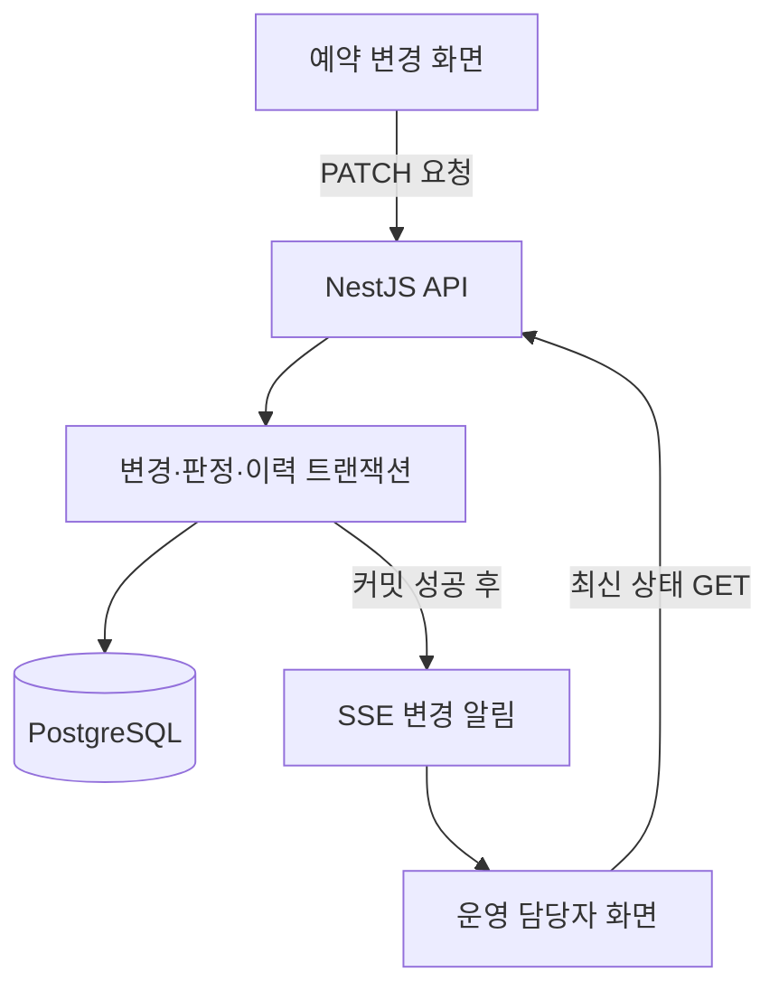

**최종 제안: 예약 변경 후 퇴실 청소 일정 불일치 점검 도구**

체크아웃 시간 변경 이후 예약 정보와 청소 일정이 일치하는지 점검하고, 운영 담당자가 불일치를 수정한 뒤 정상 상태를 확인할 수 있는 웹 도구를 구현한다.

과제의 평가 항목인 **문제 정의, 구현 범위 판단, 구현 완성도, AI 활용 및 검토 과정**을 하나의 처리 흐름으로 설명할 수 있도록 구성한다.

**1. 문제 정의**

숙박 예약의 체크아웃 시간이 변경되면 해당 예약에 연결된 퇴실 청소 일정도 재확인해야 한다.

다음 상황을 가정한다.

- 고객의 체크아웃 시간이 11시에서 13시로 변경됨.
- 예약 정보에는 변경 사항이 반영됨.
- 청소 작업은 기존 11시 30분으로 유지됨.
- 운영 담당자가 불일치를 발견하지 못하면 고객이 투숙 중인 객실에 청소 직원이 방문할 수 있음.

문제는 **예약 변경 후 관련 업무에 반영되지 않은 항목을 운영 담당자가 개별적으로 대조해야 한다는 것**이다.

핸디즈에서 해당 문제가 현재 발생한다고 주장하지 않는다. 공개 자료에서 확인한 예약·현장 업무의 연계 구조를 바탕으로 설정한 과제용 가정이다.

**2. 대상 사용자와 사용 목적**

| 항목 | 정의 |
|---|---|
| 대상 사용자 | 예약 변경과 퇴실 청소 일정을 확인하는 운영 담당자 |
| 사용 시점 | 체크아웃 시각 또는 청소 일정 변경 후 |
| 필요한 판단 | 청소가 체크아웃 이전에 시작하도록 배정되어 있는지 확인 |
| 필요한 조치 | 예약 변경 이력 확인 후 청소 일정 수정 |
| 기대 효과 | 예약과 청소 일정을 개별적으로 대조하는 작업 축소 |
| 검증 범위 | 불일치 검출, 조치, 재점검, 화면 갱신의 정확성 |

실제 운영 시간이나 고객 불편 감소율은 측정하지 않으므로 성과로 제시하지 않는다.

**3. 제출할 결과물**

예약 데이터와 청소 작업 데이터를 비교해 **점검 결과·판정 근거·변경 이력**을 표시하는 웹 도구를 제출한다.

| 예약 번호 | 체크아웃 예정 | 청소 시작 예정 | 판정 | 근거 |
|---|---|---|---|---|
| R-101 | 13:00 | 11:30 | 불일치 | 체크아웃 이전에 청소 시작 예정 |
| R-102 | 13:00 | 13:30 | 정상 | 체크아웃 이후 청소 시작 예정 |
| R-103 | 12:00 | 작업 없음 | 확인 필요 | 대응하는 퇴실 청소 작업 없음 |
| R-104 | 정보 누락 | 12:30 | 판정 불가 | 체크아웃 예정 시각 없음 |

운영자는 불일치 건을 선택해 변경 이력을 확인하고 청소 시간을 수정한다. 저장 후 재점검 결과가 정상으로 변경되는 것을 확인한다.

**4. 구현 범위**

첫 구현은 **체크아웃 시각과 퇴실 청소 시작 시각의 일치 여부**로 제한한다.

| 구현 포함 | 구현 제외 |
|---|---|
| 샘플 예약·청소 데이터 | 실제 PMS·OTA 연결 |
| 체크아웃 시각 변경 | 예약 생성·결제·환불 |
| 불일치 자동 판정 | 청소 인력 최적 배정 |
| 판정 근거 표시 | 도어락·주차 시스템 제어 |
| 청소 일정 수정 및 재점검 | 고객 메시지 실제 발송 |
| 변경·조치 이력 | 복잡한 사용자 권한 체계 |
| 다른 운영 화면의 실시간 갱신 | 앱을 종료한 사용자 대상 Push |

출입·주차까지 포함하면 시스템별 정책과 실패 조건을 추가로 정의해야 한다. 이번 제출에서는 **불일치 발견 → 조치 → 정상 여부 재확인**을 완결한다.

**5. 운용 가정 및 판정 기준**

아래 기준은 실제 숙소 정책이 아니라 과제에서 채택한 가정으로 문서화한다.

- 예약 1건에 연결되는 퇴실 청소 작업은 최대 1건이다.
- 재실 청소는 점검 대상에서 제외한다.
- 청소 시작 시각은 체크아웃 예정 시각과 같거나 늦어야 한다.
- 점검은 예정 시각을 비교한다. 실제 퇴실 여부는 별도로 확인하지 않는다.
- 정상 판정은 시간상 충돌이 없다는 의미다. 청소 인력 확보나 다음 입실 전 청소 완료까지 보장하지 않는다.

| 조건 | 판정 |
|---|---|
| 청소 시작 시각 < 체크아웃 예정 시각 | `CONFLICT` — 불일치 |
| 청소 시작 시각 ≥ 체크아웃 예정 시각 | `NORMAL` — 정상 |
| 대응하는 퇴실 청소 작업 없음 | `NEEDS_CHECK` — 확인 필요 |
| 필수 시각 또는 연결 정보 누락 | `UNDETERMINED` — 판정 불가 |
| 예약 취소 | `EXCLUDED` — 점검 대상 제외 |

**6. 기술 스택**

| 구분 | 선정 기술 | 책임 |
|---|---|---|
| FE | React + TypeScript + Vite | 예약 변경, 점검 목록, 조치·이력 화면 |
| FE 서버 상태 | TanStack Query | 조회 결과 관리, 변경 알림 수신 시 재조회 |
| BE | NestJS + TypeScript | 입력 검증, 변경 처리, 판정, 이력 기록, SSE |
| DB | PostgreSQL | 예약·청소·점검 결과·이력 영속 저장 |
| DB 접근 | Prisma | 스키마, 마이그레이션, 트랜잭션 |
| 실시간 전달 | SSE | 서버에서 운영 화면으로 변경 알림 전달 |
| 실행 환경 | Docker Compose | 동일한 절차로 앱과 DB 실행 |
| 검증 | BE 통합 테스트 + Playwright | 정합성 및 두 화면 간 갱신 확인 |

FE 빌드 결과를 BE에서 함께 제공한다. 실행 구성은 **앱 컨테이너 1개와 DB 컨테이너 1개**로 제한한다. BE는 상시 실행되는 단일 인스턴스를 전제로 한다.

**7. 시스템 구조 및 처리 순서**



처리 순서는 다음과 같다.

1. FE가 변경할 시각과 현재 데이터 버전을 전송한다.
2. BE가 입력값을 검증하고 해당 예약의 동시 변경을 제어한다.
3. 예약 또는 청소 일정을 수정한다.
4. 최신 예약·청소 데이터를 비교해 점검 결과를 갱신한다.
5. 변경 전후 값과 처리자를 이력에 기록한다.
6. 위 변경을 하나의 DB 트랜잭션으로 확정한다.
7. 커밋 성공 후 연결된 운영 화면에 SSE 알림을 전송한다.
8. FE가 관련 데이터를 재조회해 화면을 갱신한다.

**예약 변경과 점검 결과 저장은 함께 성공하거나 함께 실패해야 한다.** 청소 일정 수정 경로에서도 같은 재판정 절차를 수행한다.

**8. DB 정의**

| 테이블 | 주요 필드 | 용도 |
|---|---|---|
| `reservations` | `id`, `room_id`, `checkout_at`, `status`, `version` | 예약 최신 상태 |
| `cleaning_tasks` | `id`, `reservation_id`, `scheduled_start_at`, `status`, `version` | 예약에 연결된 퇴실 청소 |
| `inspection_results` | `reservation_id`, `status`, `reason_code`, `checked_at` | 현재 점검 결과 |
| `audit_logs` | `reservation_id`, `action`, `before`, `after`, `actor_id`, `created_at` | 변경·조치 이력 |

설계 기준은 다음과 같다.

- 예약과 청소 작업은 외래 키로 연결한다.
- 예약당 청소 작업 및 현재 점검 결과의 중복 생성을 제약 조건으로 방지한다.
- 시각은 `timestamptz`로 저장하고, 화면에서는 숙소 시간대로 표시한다.
- 상태·시각·관계는 명시적인 컬럼으로 관리한다.
- 이력의 변경 전후 값은 JSON으로 기록할 수 있다.
- 과제에서는 고정된 데모 처리자를 사용하며, 운영용 인증·권한은 별도 범위로 명시한다.

예약 변경과 청소 일정 변경은 모두 같은 예약 행을 먼저 잠근 후 처리한다. 사용자가 오래된 버전의 데이터를 수정하면 `409 Conflict`를 반환해 최신 상태 확인을 요구한다.

**9. API 정의**

| API | 처리 내용 |
|---|---|
| `GET /reservations` | 예약 및 점검 상태 조회 |
| `PATCH /reservations/:id/checkout` | 체크아웃 변경 및 재판정 |
| `PATCH /cleaning-tasks/:id/schedule` | 청소 일정 변경 및 재판정 |
| `GET /inspection-results` | 점검 결과 조회 및 상태별 필터링 |
| `GET /reservations/:id/audit-logs` | 변경·조치 이력 조회 |
| `GET /events` | SSE 연결 |

변경 API는 저장된 최신 데이터와 판정 결과를 반환한다. 요청한 화면은 응답으로 즉시 갱신하고, 다른 화면은 SSE 알림을 받아 재조회한다.

**10. 실시간 처리 및 장애 복구**

실시간 목표는 **정상 연결 상태에서 변경 확정 후 2초 이내 다른 운영 화면에 반영**하는 것이다. 구현 후 실제 측정값을 기록한다.

사용자 입력은 HTTP API로 처리하고, 서버에서 화면으로 전달하는 변경 알림은 SSE로 처리한다. SSE는 서버에서 브라우저로 전달하는 단방향 통신에 적합하다. [developer.mozilla.org](https://developer.mozilla.org/en-US/docs/Web/API/EventSource?authuser=1\&utm_source=chatgpt.com)

알림에는 전체 예약 정보 대신 재조회에 필요한 식별자를 넣는다.

```json
{
  "type": "reservation.updated",
  "reservationId": "R-101",
  "version": 4
}
```

FE의 처리 기준은 다음과 같다.

- 화면당 SSE 연결 1개를 유지한다.
- 연결이 열린 뒤 최신 데이터를 조회한다.
- 이벤트 수신 시 관련 데이터를 재조회한다.
- 재연결 시 현재 목록을 다시 조회한다.
- 연결 끊김과 마지막 갱신 시각을 표시한다.
- 알림 누락에 대비해 30초 주기 및 화면 복귀 시 재조회한다.

**DB가 상태의 기준이며, SSE는 갱신 신호로 사용한다.** SSE 연결이 끊겨도 불일치 판정과 이력 저장은 수행되어야 한다.

DB 커밋 직후 SSE 발송 전에 서버가 종료되면 즉시 알림이 누락될 수 있다. 이 경우 재연결 또는 주기적 조회로 최신 상태를 복원한다. 초기 범위에는 이벤트 영구 보관과 재생 기능을 포함하지 않는다.

**11. Redis 및 별도 Push 서버 도입 판단**

| 구성 요소 | 초기 결정 | 도입 조건 |
|---|---|---|
| Redis 캐시 | 제외 | DB 조회가 실제 병목으로 확인될 때 |
| Redis Pub/Sub | 제외 | BE 다중 인스턴스 간 변경 알림 공유가 필요할 때 |
| Redis Streams 등 작업 큐 | 제외 | 외부 연동의 작업 보존·재시도·비동기 처리가 필요할 때 |
| 별도 Push 서버 | 제외 | 연결 처리와 API 부하를 독립적으로 확장해야 할 때 |
| 웹·모바일 Push | 제외 | 운영 화면을 닫은 사용자에게 알림이 필요할 때 |

단일 BE에서는 자체 SSE 연결 관리로 충분하다. Redis Pub/Sub은 연결되지 않은 구독자에게 메시지를 보존하지 않으므로, 추가하더라도 DB 재조회 등의 복구 절차는 필요하다. [redis.io](https://redis.io/docs/latest/develop/use-cases/pub-sub/?utm_source=chatgpt.com)

향후 외부 시스템에 반드시 전달해야 하는 작업이 생기면 **DB Outbox와 재시도 작업자**를 검토한다. 현재 과제에는 적용하지 않는다.

**12. 검증 항목 및 합격 기준**

| 시험 조건 | 합격 기준 |
|---|---|
| 체크아웃을 11시에서 13시로 변경, 청소는 11시 30분 유지 | 불일치 검출 |
| 청소를 13시 30분으로 수정 | 재점검 결과 정상 |
| 청소와 체크아웃 시각이 같음 | 정의한 기준에 따라 정상 |
| 청소 작업 없음 | 확인 필요 표시 |
| 필수 시각 누락 | 판정 불가 및 원인 표시 |
| 취소 예약 | 점검 대상 제외 |
| 판정 저장 중 오류 | 예약 변경까지 롤백 |
| 두 사용자가 같은 데이터를 수정 | 오래된 버전의 덮어쓰기 방지 |
| 예약과 청소 일정 동시 수정 | 최종 저장값과 점검 결과 일치 |
| 다른 운영 화면을 열어둔 상태에서 변경 | 정상 연결 시 목표 시간 안에 갱신 |
| SSE 연결 해제 중 변경 | 재연결 후 최신 상태 복구 |
| BE 재시작 | 저장된 예약·점검·이력 유지 |
| 동일 점검 반복 | 결과 중복 생성 없음 |

판정 함수의 경계 조건은 단위 테스트로 확인한다. 트랜잭션·동시 수정은 실제 PostgreSQL을 사용하는 통합 테스트로 확인한다. 두 화면 간 갱신과 재연결은 브라우저 테스트로 확인한다.

**13. AI 활용 및 검토 계획**

AI는 조사·설계·구현·테스트 작성에 사용한다. 운영 판정은 명시적인 규칙을 구현한 코드가 수행한다.

| AI 활용 작업 | 사람이 검토할 사항 | 제출할 기록 |
|---|---|---|
| 문제 상황·예외 조건 제안 | 확인 사실과 가정 구분 | 채택·기각한 가정과 이유 |
| DB·API 초안 작성 | 관계, 제약 조건, 트랜잭션 범위 | 설계 수정 내역 |
| 화면·서버 코드 작성 | 입력 검증, 시간 비교, 동시 수정 | 코드 수정 근거 |
| 테스트 사례 제안 | 경계값·누락·재연결 조건 포함 여부 | 추가·수정한 시험 항목 |
| 코드 리뷰 | 실패 시 부분 저장, 중복 처리, 상태 복구 | 발견 사항과 재검증 결과 |

예를 들어 AI가 ‘청소 작업 없음’을 정상으로 처리했다면, 정보 부재를 정상으로 판단할 수 없다는 이유로 수정한다. 이후 동일 오류를 검출하는 테스트를 추가한다.

이는 기록 방식의 예시이며, **제출 기록에는 실제 수행한 요청·검토·수정만 포함**한다.

**14. 제출 구성 및 시연 절차**

저장소에는 다음 항목을 포함한다.

| 제출 항목 | 내용 |
|---|---|
| 실행 가능한 코드 | FE·BE·DB 마이그레이션·샘플 데이터 |
| `README.md` | 문제 정의, 근거, 가정, 범위, 실행 방법 |
| `DESIGN.md` | 구조, 데이터 모델, 실시간 처리, 제외한 기술과 이유 |
| `TEST_REPORT.md` | 시험 조건, 예상 결과, 실제 결과, 미해결 사항 |
| `AI_USAGE.md` | AI 활용 내역, 검토 및 수정 근거 |
| Docker Compose | 재현 가능한 실행 구성 |

평가자는 다음 순서로 결과물을 확인한다.

1. 샘플 데이터를 적재하고 예약 변경 화면과 운영 화면을 연다.
2. 체크아웃 시간을 연장한다.
3. 다른 운영 화면에서 불일치와 판정 근거를 확인한다.
4. 청소 일정을 수정한다.
5. 정상 판정으로 변경되는 것을 확인한다.
6. 변경·조치 이력을 확인한다.
7. 연결을 끊었다가 복구하여 최신 상태가 다시 표시되는지 확인한다.

이 구성은 작은 범위 안에서 **문제 정의, 규칙의 명확성, 데이터 정합성, 실시간 전달, 장애 복구, AI 검토 과정**을 함께 평가할 수 있도록 한다.
**15. 사용자 역할별 화면과 권한 (추가 요구)**

사용자별로 수행하는 업무가 다르므로 FE 화면도 달라져야 한다. 앞선 제안에서는 변경을 입력하는 사람과 불일치를 조치하는 사람의 구분이 빠졌다.

다만 **화면을 구분하는 것과 FE 앱을 별도로 만드는 것은 다르다.** 이번 과제는 React 앱 하나에서 역할별 경로를 구분한다.

**15.1 사용자별 업무와 화면**

| 사용자 | 수행 업무 | 필요한 정보 | 가능한 조작 |
|---|---|---|---|
| **예약·고객 응대 담당자** | 고객 요청에 따라 체크아웃 변경 | 예약 정보, 기존·변경 시각, 변경 결과 | 체크아웃 변경, 사유 입력 |
| **현장 운영 담당자** | 변경이 청소 일정에 미치는 영향 확인 및 조치 | 불일치 목록, 청소 일정, 판정 근거, 변경 이력 | 청소 일정 수정, 조치 결과 확인 |
| **청소 담당자** | 배정된 일정에 따라 작업 수행 | 담당 객실, 작업 예정 시각, 변경 안내 | 작업 확인, 시작·완료 처리 |

이 역할 구분은 **과제용 운영 가정**이다. 실제 조직에서는 한 사람이 예약·현장 운영 업무를 함께 수행할 수 있다.

**15.2 이번 과제에서는 두 화면을 구현한다**

**예약·고객 응대 화면 — `/reservations`**

예약을 조회하고 고객의 체크아웃 변경을 입력하는 화면이다.

- 예약 번호·객실·체크아웃 예정 시각 표시.
- 변경 시각과 변경 사유 입력.
- 저장 결과와 후속 일정 충돌 여부 표시.
- 충돌 발생 시 ‘예약 변경 완료 / 청소 일정 조정 필요’로 구분해 안내.

예를 들어 체크아웃을 13시로 변경했을 때 다음 결과를 표시한다.

> 예약 변경 완료
> 기존 청소 시작: 11:30
> 체크아웃 이전에 청소가 예정되어 있습니다. 운영 담당자의 일정 조정이 필요합니다.

**현장 운영 화면 — `/operations`**

조치가 필요한 예약을 확인하고 청소 일정을 수정하는 화면이다.

- 불일치·확인 필요·판정 불가 건 우선 표시.
- 체크아웃 시각과 청소 시각을 나란히 표시.
- 상세 화면에서 변경 사유·변경자·이력 확인.
- 청소 시간 수정 후 자동 재점검.
- 정상 처리된 건도 이력에서 조회 가능.

예약 담당자가 변경하면 **현장 운영 화면이 SSE로 갱신**된다. 현장 운영 담당자가 청소 일정을 수정하면 **예약 담당자 화면에도 정상 판정이 반영**된다.

**15.3 청소 담당자 화면은 이번 범위에서 제외한다**

청소 담당자 화면까지 구현하려면 담당자 배정, 모바일 사용, 작업 시작·완료, 일정 변경 확인 여부를 추가로 정의해야 한다.

이번 과제의 완료 기준은 **‘예약 변경과 청소 예정 시각의 불일치 해소’**이므로 두 화면으로 검증할 수 있다. 단, **실제 청소 담당자가 변경 내용을 전달받고 확인했는지는 검증 범위 밖**이라고 명시해야 한다.

**15.4 FE·BE 구성도 역할을 반영한다**

| 구분 | 예약·고객 응대 담당자 | 현장 운영 담당자 |
|---|---|---|
| FE 경로 | `/reservations` | `/operations` |
| 주요 조회 | 예약 중심 | 점검 결과 중심 |
| 변경 권한 | 체크아웃 시각 변경 | 청소 일정 변경 |
| 공통 조회 | 판정 결과·변경 이력 | 판정 결과·변경 이력 |
| 실시간 처리 | 변경 알림 수신 후 재조회 | 변경 알림 수신 후 재조회 |

**버튼을 숨기는 것만으로 권한 처리를 끝내면 안 된다.** BE에서도 역할별 변경 API 접근을 검사해야 한다.

과제에서는 계정 가입 기능 없이 **고정된 데모 계정 두 개**를 제공한다. 서버가 계정의 역할과 처리자를 결정하고 변경 이력에 기록한다. FE가 요청 본문에 임의로 적은 역할·처리자 값을 신뢰하지 않는다.

시연도 **예약 담당자 브라우저와 현장 운영 담당자 브라우저를 각각 열어**, 서로 다른 화면에서 변경·발견·조치·재확인이 이어지는 방식으로 구성한다.
