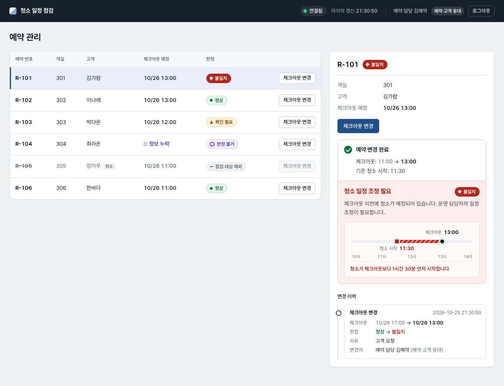
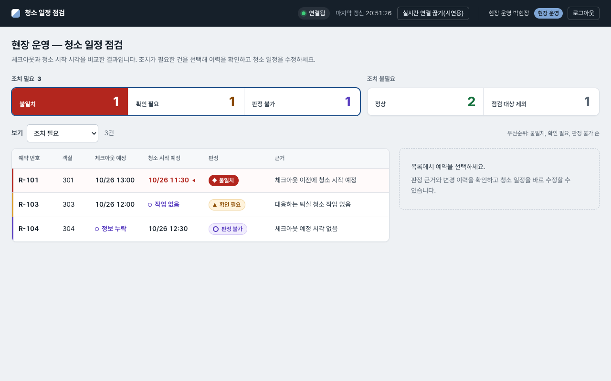
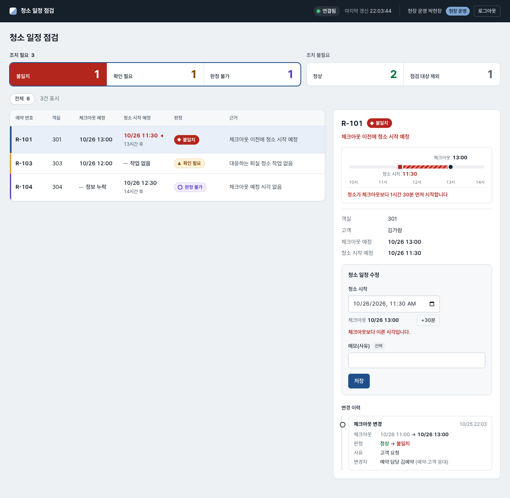
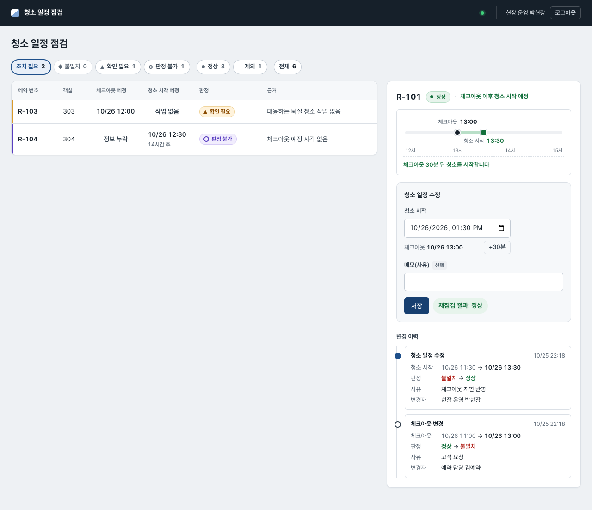
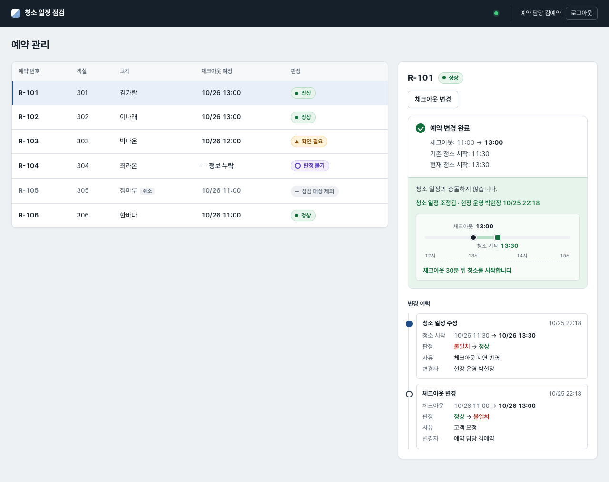
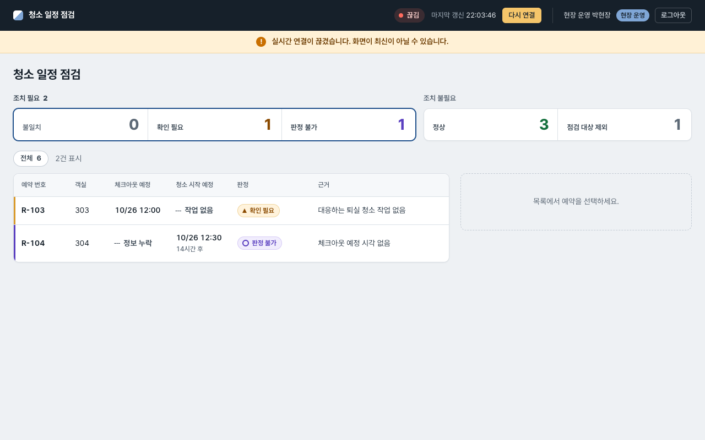

# 예약 변경 후 퇴실 청소 일정 불일치 점검 도구

체크아웃 시각이 바뀐 뒤 퇴실 청소 시작 시각이 체크아웃보다 앞서 남아 있는지 자동으로 판정하고, 현장 운영 담당자가 청소 일정을 고친 뒤 정상 판정을 다시 확인하는 웹 도구다. 처리 흐름은 **발견 → 조치 → 재확인** 하나로 제한했다.

| 문서 | 내용 |
|---|---|
| `README.md` | 문제 정의, 가정·판정 기준, 범위, 실행 방법, 시연 절차 |
| [`DESIGN.md`](DESIGN.md) | 구조, 데이터 모델, 트랜잭션·잠금, 인증·역할, API, 실시간 처리, 제외한 기술 |
| [`TEST_REPORT.md`](TEST_REPORT.md) | 시험 조건별 예상·실제 결과와 근거 테스트, 지연 실측값, 미해결 사항 |
| [`AI_USAGE.md`](AI_USAGE.md) | AI 활용 과정, 리뷰 발견 사항, 수정 커밋, 사람이 지적한 사항 |

## 1. 문제 정의

숙박 예약의 체크아웃 시각이 바뀌면 그 예약에 연결된 퇴실 청소 일정도 다시 확인해야 한다. 과제에서는 다음 상황을 가정했다.

- 고객의 체크아웃이 11:00에서 13:00으로 바뀌고, 예약 정보에는 반영된다.
- 퇴실 청소는 기존 11:30으로 남는다.
- 운영 담당자가 이 불일치를 놓치면 고객이 머무는 객실에 청소 직원이 들어갈 수 있다.

해결하려는 문제는 **예약 변경 후 후속 업무에 반영되지 않은 항목을 운영 담당자가 직접 대조해야 한다는 점**이다.

### 근거

공개 자료에서 확인한 예약·현장 업무의 연계 구조는 다음과 같다.

- OTA 예약은 자체 시스템으로 자동 연동된다. 자동화 이전에는 "고객이 야놀자나 이런 데서 예약을 하면 담당 직원이 그 예약 내용을 보고 현장 직원에게 전화를 걸거나 슬랙 메신저를 통해서 예약 내용을 알려"주는 방식이었다. — [이 호텔 운영사는 왜 CTO를 뽑았나 (바이라인네트워크, 2024-06)](https://byline.network/2024/06/cto1/)
- 고객은 어반스테이 앱에서 레이트 체크아웃을 신청할 수 있다. 즉 체크아웃 시각은 예약 이후에도 바뀐다. — 같은 기사, [어반스테이 공식 홈페이지](https://urbanstay.co.kr/home)
- 기타 참고: [핸디즈 채용 홈페이지](https://careers.handys.co.kr/), [국내 1위 레지던스 호텔 운영사 ‘핸디즈’의 비결은 (조선일보 WEEKLY BIZ, 2025-08-28)](https://www.chosun.com/economy/weeklybiz/2025/08/28/GI7ZKYTQCNHCTKL7N65UJ6ITYM/)

예약 정보는 시스템으로 연동되지만 현장 업무(청소)는 그 예약을 기준으로 따로 움직인다. 이 구조에서 예약 이후의 변경(레이트 체크아웃)이 청소 일정에 반영됐는지 확인하는 일을 과제 대상으로 골랐다.

핸디즈에서 이 문제가 실제로 발생한다고 주장하지 않는다. 위 연계 구조를 바탕으로 세운 과제용 가정이다. 운영 시간 절감이나 고객 불편 감소율은 측정하지 않았으므로 성과로 제시하지 않는다.

## 2. 대상 사용자와 역할

| 역할 | 화면 | 하는 일 | 변경 권한 |
|---|---|---|---|
| 예약·고객 응대 담당자 (`RESERVATION_AGENT`) | `/reservations` | 고객 요청에 따라 체크아웃 시각과 사유 입력, 저장 결과와 청소 일정 충돌 여부 확인 | 체크아웃 변경만 |
| 현장 운영 담당자 (`OPERATIONS_MANAGER`) | `/operations` | 불일치·확인 필요·판정 불가 건 확인, 판정 근거와 변경 이력 확인, 청소 시작 시각 수정 | 청소 일정 변경만 |

- React 앱 하나에서 역할별 경로를 나눴다. 권한은 화면에서 버튼을 숨기는 데 그치지 않고 서버가 역할을 검사한다(다른 역할의 변경 API는 403).
- 처리자와 역할은 서버가 로그인 세션에서 정한다. 요청 본문에 `actorId`·`role`을 넣으면 400으로 거부한다.
- 역할 구분은 과제용 운영 가정이다. 실제 조직에서는 한 사람이 두 업무를 함께 할 수 있다.
- **청소 담당자 화면은 범위에서 제외했다.** 담당자 배정, 모바일 사용, 작업 시작·완료, 변경 확인 여부를 따로 정의해야 하기 때문이다. 이번 완료 기준은 "예약 변경과 청소 예정 시각의 불일치 해소"이며, **실제 청소 담당자가 변경 내용을 전달받고 확인했는지는 검증 범위 밖**이다.

## 3. 운용 가정과 판정 기준

실제 숙소 정책이 아니라 과제에서 채택한 가정이다.

- 예약 1건에 연결되는 퇴실 청소 작업은 최대 1건이다(DB 부분 유니크 인덱스로 강제).
- 재실 청소(`STAYOVER`)는 점검 대상에서 제외한다.
- 청소 시작 시각은 체크아웃 예정 시각과 같거나 늦어야 한다. 같으면 정상이다.
- 예정 시각만 비교한다. 실제 퇴실 여부는 확인하지 않는다.
- 정상 판정은 시간상 충돌이 없다는 뜻이다. 청소 인력 확보나 다음 입실 전 청소 완료를 보장하지 않는다.
- 시각은 DB에 `timestamptz`로 저장하고 화면에는 숙소 시간대 `Asia/Seoul`로 표시한다.

판정은 순수 함수 `judge`(`apps/server/src/inspection/judge.ts`)가 아래 순서로 수행하며, 먼저 걸리는 조건이 판정이 된다.

| 순서 | 조건 | 판정 | 근거 문구 |
|---|---|---|---|
| 1 | 예약 취소 | `EXCLUDED` 점검 대상 제외 | 취소된 예약으로 점검 대상에서 제외 |
| 2 | 체크아웃 예정 시각 없음 | `UNDETERMINED` 판정 불가 | 체크아웃 예정 시각 없음 |
| 3 | 활성 퇴실 청소 작업 없음(없거나 취소됨) | `NEEDS_CHECK` 확인 필요 | 대응하는 퇴실 청소 작업 없음 |
| 4 | 청소 시작 예정 시각 없음 | `UNDETERMINED` 판정 불가 | 청소 시작 예정 시각 없음 |
| 5 | 청소 시작 < 체크아웃 | `CONFLICT` 불일치 | 체크아웃 이전에 청소 시작 예정 |
| 6 | 청소 시작 ≥ 체크아웃 | `NORMAL` 정상 | 체크아웃 이후 청소 시작 예정 |

- 2번을 3번보다 먼저 본다. 체크아웃 시각이 없으면 청소 작업 유무와 관계없이 비교 자체가 불가능하기 때문이다(시드 R-104: 체크아웃 누락 + 청소 12:30 → 판정 불가).
- 정보가 없는 경우(작업 없음, 시각 누락)는 어떤 경우에도 `NORMAL`이 되지 않는다. 단위 테스트가 이를 확인한다.
- 비교는 epoch ms 기준이라 시간대와 무관하다.

시드 데이터(기준일 2026-10-26 KST):

| 예약 | 체크아웃 | 퇴실 청소 | 초기 판정 |
|---|---|---|---|
| R-101 | 11:00 | 11:30 | 정상 (시연에서 체크아웃을 13:00으로 변경 → 불일치) |
| R-102 | 13:00 | 13:30 | 정상 |
| R-103 | 12:00 | 없음(재실 청소만 있음) | 확인 필요 |
| R-104 | 없음 | 12:30 | 판정 불가 |
| R-105 | 11:00 (취소 예약) | 12:00 | 점검 대상 제외 |
| R-106 | 11:00 | 11:00 | 정상(같은 시각 경계) |

## 4. 구현 범위

| 구현 포함 | 구현 제외 |
|---|---|
| 샘플 예약·청소 데이터(시드) | 실제 PMS·OTA 연결 |
| 체크아웃 시각 변경(사유 필수) | 예약 생성·결제·환불 |
| 불일치 자동 판정과 근거 표시 | 청소 인력 배정 |
| 청소 일정 수정과 자동 재점검 | 도어락·주차 시스템 제어 |
| 변경·조치 이력(전후 값, 판정 전후, 사유, 처리자) | 고객 메시지 발송 |
| 역할별 두 화면과 서버 측 역할 검사, 고정 데모 계정 2개 | 계정 가입, 운영 수준 인증·권한 체계 |
| SSE로 다른 화면 갱신, 끊김 표시, 재연결 후 복구 | 앱을 닫은 사용자 대상 Push, 이벤트 영구 보관·재생 |
| 오래된 버전의 덮어쓰기 방지(409) | 청소 담당자 화면 |

GOAL.md와 다르게 정한 부분:

- API 경로는 모두 `/api` 아래에 둔다(예: `PATCH /api/reservations/:id/checkout`). Nest가 빌드된 SPA를 같은 origin에서 제공하므로 `/reservations` 같은 화면 경로와 API 경로가 겹치지 않게 하려는 것이다.
- `POST /api/inspection-results/run`(전체 재점검)을 추가했다. "동일 점검 반복 시 결과 중복 없음"을 검증하기 위한 것이다. 현장 운영 담당자만 호출할 수 있고 200 `{checked: n}`을 반환한다.
- 취소된 예약의 체크아웃·청소 변경은 `422`로 거부한다.
- GOAL §8의 "고정된 데모 처리자"는 §15에 따라 서명 쿠키 세션의 데모 계정 2개로 바꿨다.

## 5. 화면

| 예약 담당자: 체크아웃 변경 결과(불일치) | 현장 운영: 조치 필요 목록 |
|---|---|
|  |  |

| 현장 운영: 판정 근거·이력·청소 일정 수정 | 현장 운영: 수정 후 정상 |
|---|---|
|  |  |

| 예약 담당자 화면에 정상 반영 | 실시간 연결 끊김 표시 |
|---|---|
|  |  |

전체 18장(데스크톱 1280px, 모바일 390px)은 `docs/screenshots/`에 있다. 스크린샷은 `npm run screenshots`로 생성했다(헤드리스 Chromium, en-US 로캘이라 날짜 입력칸이 `10/26/2026, 11:30 AM` 형식으로 보인다). 다시 찍으려면 `npm run setup`으로 시드 상태를 만들고 `npm run dev`를 띄운 뒤 실행한다. 스크립트가 UI로 R-101을 변경하므로 R-101에 이력이 있으면 실행을 거부한다. 대상 주소는 `SCREENSHOT_URL`(기본 http://localhost:5300), 저장 위치는 `SCREENSHOT_DIR`(기본 `docs/screenshots`)로 바꿀 수 있다.

## 6. 실행 방법

모든 명령은 저장소 루트에서 실행한다.

### 6.1 로컬 실행

필요 조건: Node 22 이상(`.nvmrc`), 로컬 PostgreSQL 15 이상.

```bash
npm install

# 개발 서버용 설정. USER를 로컬 PostgreSQL 사용자로 바꾼다.
cp .env.example apps/server/.env

npm run setup   # handys DB를 마이그레이션 + 시드 상태로 초기화
npm run dev     # API :3300 + Vite :5300
```

`handys`, `handys_test`, `handys_e2e` DB는 없으면 `npm run setup`, `npm run test:int`, `npm run e2e`가 각각 만든다(`prisma migrate reset`).

브라우저에서 http://localhost:5300 을 연다.

- `npm run setup`은 로컬 호스트(`localhost`, `127.0.0.1`, `::1`)의 `handys` DB만 초기화한다. 다른 이름은 `SETUP_DB_NAME`으로 명시해야 하며, 이름에 `test`나 `e2e`가 들어간 DB는 항상 거부한다. 다시 실행하면 시드 상태로 돌아간다. `npm run dev` 전에 실행한다.
- 포트는 `PORT`/`API_PORT`(API, 기본 3300)와 `WEB_PORT`(Vite, 기본 5300)로 바꿀 수 있다. Vite는 `strictPort`라 포트가 사용 중이면 다른 포트로 옮기지 않고 실패한다.
- 개발 서버는 `apps/server/dist-dev`로 빌드하므로 `npm run dev`를 켠 채 `npm run build`나 `npm run e2e`를 실행해도 개발 서버가 멈추지 않는다.

빌드 결과물로 실행(Nest가 SPA를 함께 제공):

```bash
npm run build
npm start       # http://localhost:3000 (PORT로 변경)
```

### 6.2 Docker Compose

```bash
docker compose up --build   # http://localhost:3000
```

앱 컨테이너 1개(NestJS + 빌드된 SPA)와 PostgreSQL 16 컨테이너 1개로 구성된다. 앱은 시작할 때 `prisma migrate deploy`를 실행하고, 예약이 0건일 때만 시드를 넣는다. `SESSION_SECRET` 환경 변수로 세션 서명 키를 바꿀 수 있다.

## 7. 데모 계정

로그인 화면에는 계정 정보를 표시하지 않는다.

| 아이디 | 비밀번호 | 역할 | 로그인 후 화면 |
|---|---|---|---|
| `agent` | `demo1234` | 예약·고객 응대 담당 (예약 담당 김예약) | `/reservations` |
| `ops` | `demo1234` | 현장 운영 담당 (현장 운영 박현장) | `/operations` |

세션은 브라우저별 쿠키다. 두 역할을 동시에 쓰려면 서로 다른 브라우저 두 개, 또는 일반 창과 시크릿 창을 사용한다.

## 8. 시연 절차

`npm run setup`으로 시드 상태를 만든 뒤 진행한다(Docker는 첫 실행이 시드 상태다).

1. **브라우저 A**에서 `agent`로 로그인한다(`/reservations`). **브라우저 B**에서 `http://localhost:5300/operations?demo=1`을 열고 `ops`로 로그인한다. B의 보기 필터를 "전체"로 바꾸면 R-101이 정상으로 보인다.
2. A에서 R-101을 선택하고 "체크아웃 변경"에서 체크아웃을 2026-10-26 13:00으로, 사유를 "고객 요청"으로 입력해 저장한다. 결과 패널에 "예약 변경 완료", "기존 청소 시작: 11:30", "청소 일정 조정 필요"와 안내 문구가 표시된다. "기존 청소 시작"은 저장 시점의 값이며, 이후 운영 담당자가 청소 시작을 바꾸면 "현재 청소 시작: 13:30" 줄이 함께 표시된다.
3. B는 새로고침 없이 R-101을 불일치로 표시하고, 근거 "체크아웃 이전에 청소 시작 예정"을 보여 준다. "조치 필요" 필터에서 맨 위에 온다.
4. B에서 R-101을 선택하고 청소 시작을 13:30으로 고쳐 저장한다(메모는 선택).
5. B에 "재점검 결과: 정상"이 표시되고, A의 R-101도 새로고침 없이 정상으로 바뀐다.
6. B의 상세 패널 "변경 이력"에서 체크아웃 변경(11:00 → 13:00, 정상 → 불일치, 사유, 예약 담당 김예약)과 청소 일정 변경(11:30 → 13:30, 불일치 → 정상, 현장 운영 박현장)을 확인한다.
7. B 헤더의 "연결 끊기"를 누른다. 헤더가 끊김 상태와 경고를 표시하고, 이 동안에는 변경 알림이 오지 않는다. A가 다른 예약(예: R-102)의 체크아웃을 바꾼 뒤 B에서 바로 "다시 연결"을 누르면 최신 상태가 즉시 표시된다. 끊긴 채로 오래 두면 30초 주기 재조회나 창 전환 시 재조회로 B가 먼저 따라잡을 수 있으므로, 변경 직후 바로 다시 연결한다. 브라우저 개발자 도구의 오프라인 모드로 끊었다가 복구해도 된다.

- "연결 끊기" 버튼은 `?demo=1`로 연 탭에서만 보인다(`?demo=0`으로 해제).
- 날짜·시각 입력칸의 표시 형식은 브라우저 로캘을 따른다. 한국어 브라우저는 한국어 형식, 영어 브라우저는 `MM/DD/YYYY, hh:mm AM` 형식으로 보인다. 입력값은 항상 KST로 해석한다.

## 9. 테스트

| 명령 | 내용 | 사용 DB |
|---|---|---|
| `npm test` | 서버 단위 테스트(Jest, 판정·세션), 웹 테스트(Vitest + Testing Library) | 없음 |
| `npm run test:int` | 서버 통합 테스트(Jest + supertest + 실제 PostgreSQL) | `handys_test` (이름에 `test`가 없으면 실행 거부, `TEST_DATABASE_URL`로 변경) |
| `npm run e2e` | 빌드 후 Playwright로 두 브라우저 시나리오, 갱신 지연 측정, 재연결, 권한, 화면 폭 | `handys_e2e` (서버 포트 3100, 이름에 `e2e`가 없으면 거부, `E2E_DATABASE_URL`로 변경) |
| `npm run lint` | ESLint, 경고 0개 허용 | — |
| `npm run typecheck` | server·web·e2e `tsc --noEmit` | — |

새로 clone한 환경에서는 e2e 전에 Playwright 브라우저를 한 번 받는다. 저장소에 고정된 버전(1.53.2)을 쓰도록 e2e workspace에서 실행한다.

```bash
npm exec -w e2e -- playwright install chromium
```

결과와 근거는 [`TEST_REPORT.md`](TEST_REPORT.md)에 있다.

## 10. 저장소 구성

```
apps/server   NestJS API, Prisma 스키마·마이그레이션·시드, 단위·통합 테스트
apps/web      React SPA (Vite, TanStack Query)
e2e           Playwright 테스트, 스크린샷 스크립트
docs          설계 명세, 구현 계획, 스크린샷
```
